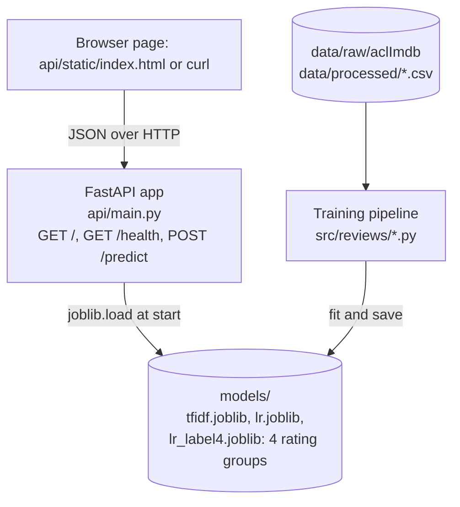

# Architecture

The system has two parts: an offline training pipeline that produces model files, and a small web service that loads those files and answers prediction requests. They share only the `models/` directory and the `clean()` function from `src/reviews/preprocess.py`, so the text a user sends is processed exactly like the training data.

## Components

- Data pipeline: `load.py`, `preprocess.py`, `eda.py` in `src/reviews/`. Python 3.13, pandas, scikit-learn. Reads the raw IMDB files, cleans the text, writes csv files.
- Training: `train_classical.py`, `train_bert.py`, `evaluate.py`. scikit-learn (TF-IDF, Naive Bayes, Logistic Regression, SVM), PyTorch and transformers for DistilBERT. Saves the fitted TF-IDF vectorizer and the logistic regression model with joblib.
- API: `api/main.py`. FastAPI and uvicorn. One request model (Pydantic) with a `text` field. Loads the joblib files once at import time and keeps them in memory. The second logistic regression (`lr_label4.joblib`) uses the same TF-IDF features and predicts one of four rating groups (1-2, 3-4, 7-8, 9-10), returned as `rating_group`.
- Demo page: `api/static/index.html`, served at `GET /`. Plain HTML with a textarea and a small script that posts to `/predict` with `fetch` and shows the label, the probability as a percent and the rating group.
- Tests: `tests/` with pytest and `fastapi.testclient`, so the API is tested without starting a server.
- Container: `Dockerfile` based on `python:3.13-slim`.

## Scalability

The service is stateless and the model is small (a sparse vector of TF-IDF weights and one coefficient vector), so a request takes a few milliseconds and one process can handle hundreds of requests per second. If more throughput is needed, the same container can be started several times behind a load balancer, or uvicorn can be run with more worker processes. Retraining is done offline and a new model is deployed by rebuilding the image with new files in `models/`. The DistilBERT model is not served because it would need a GPU or much more CPU time per request for a small gain in accuracy.

## Security

Nothing is implemented: the API has no authentication, no rate limiting and accepts any text length. This is acceptable for a thesis demo running on localhost. A public deployment would need at least an API key or token check, a limit on request size and rate, HTTPS in front of the service (usually a reverse proxy such as nginx), and the container should run as a non-root user. Input text is never executed or stored, so the attack surface is mostly denial of service.

## Deployment

The Dockerfile installs the requirements, copies `src`, `api` and `models`, installs the project package and starts uvicorn on port 8000. The image is built with `docker build -t reviews-api .` and run with `docker run -p 8000:8000 reviews-api`. The model files are copied into the image, so the container has no external dependencies at runtime. Locally, the same app runs with `.venv/bin/uvicorn api.main:app` after the training scripts have produced `models/`.
